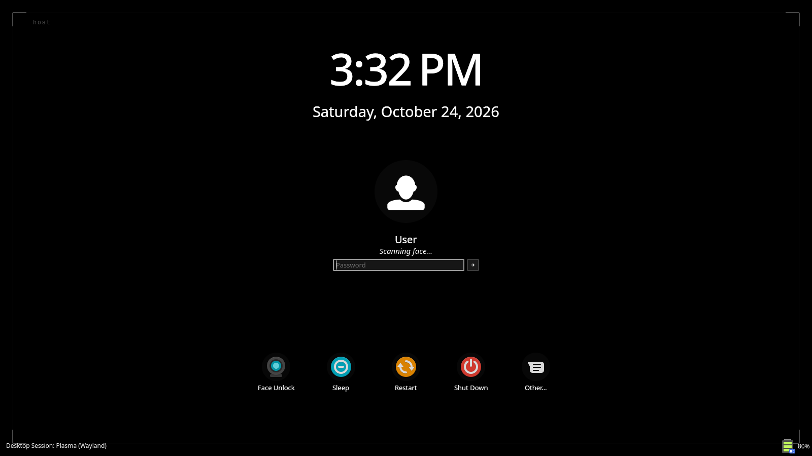
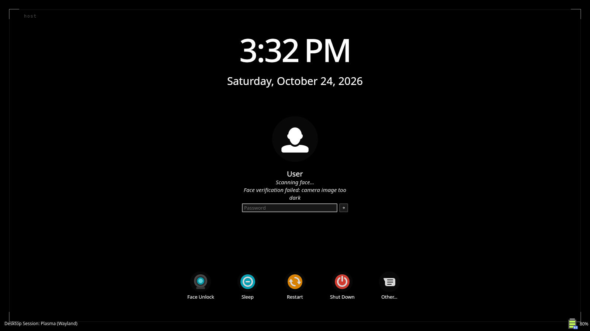

# onyx-greeter

**English** · [Türkçe](README.tr.md)

A true-black SDDM login screen and a matching lock-screen backdrop for KDE
Plasma 6 on Wayland.



> **A note before you start:** onyx-greeter was originally built for my own setup and daily use, and later shared in case it helps someone else. It reflects my own hardware, tools and preferences, so it may not fit every system or workflow. Issues and suggestions are welcome, but please keep that in mind.



The login screen is built on `org.kde.breeze.components`, the same QML module
Plasma's own lock screen uses, so the avatar, clock, action buttons and the
rejected-password animation are the same widgets on both screens and follow
the active colour scheme. Both screens share one backdrop file
(`shared/Backdrop.qml`): black, a hairline frame, four corner marks and a small
caption.

| Part | What it is | Installed to |
|---|---|---|
| login screen | SDDM theme | `/usr/share/sddm/themes/onyx` |
| lock screen | wallpaper plugin | `~/.local/share/plasma/wallpapers/org.lckt0.onyx` |

The lock screen's password box and buttons stay Plasma's own: replacing them
would require a different Plasma shell package, which onyx does not do.

> **Compatibility:** works on Plasma 6.7 and 6.8. The on-screen keyboard
> comes from Qt Virtual Keyboard on 6.7 and from KWin on 6.8, the same way
> Plasma's own Breeze login screen does it on each version.

## Installation

### Requirements

- KDE Plasma 6 and SDDM with the Qt 6 greeter
- A dark colour scheme for the full effect (the theme takes its colours from
  the active scheme)
- Optional: [howdy](https://github.com/boltgolt/howdy) for face unlock

### Arch Linux

There is no AUR package yet. Clone the repository and run the install script:

```sh
git clone https://github.com/lckt0/onyx-greeter.git
cd onyx-greeter
./install.sh
```

### Install script

```sh
./install.sh                  # both halves, selected
./install.sh --sddm           # login screen only
./install.sh --lock           # lock screen only
./install.sh --no-select      # install the files, keep the current selection
./install.sh --no-appearance  # do not touch the greeter's profile
```

The login screen changes at the next login screen and the lock screen at the
next lock; no logout is needed. The corner caption defaults to the host name;
override it with `ONYX_CAPTION="..." ./install.sh`.

Everything the script writes:

```
/usr/share/sddm/themes/onyx/                     the theme
/etc/sddm.conf.d/kde_settings.conf               [Theme] Current=onyx
~/.local/share/plasma/wallpapers/org.lckt0.onyx/ the backdrop
~/.config/kscreenlockerrc                        [Greeter] WallpaperPlugin=org.lckt0.onyx
/var/lib/sddm/.config/{kdeglobals,plasmarc}      colours, accent, icons, style
/var/lib/sddm/.local/share/...                   copies of those packages
```

The last two lines are skipped with `--no-appearance`. SDDM runs the greeter as
the `sddm` user, which cannot read a `0700` home directory, so without them the
login screen falls back to stock Breeze colours and icons. Both config files
are backed up as `*.onyx-backup` before the first write.

### Manual installation

```sh
sudo install -d /usr/share/sddm/themes/onyx
sudo install -m644 sddm/*.qml sddm/metadata.desktop sddm/theme.conf sddm/preview.png /usr/share/sddm/themes/onyx/

mkdir -p ~/.local/share/plasma/wallpapers/org.lckt0.onyx
cp -rL wallpaper/. ~/.local/share/plasma/wallpapers/org.lckt0.onyx/
```

Then select them:

- **Login screen:** System Settings → Colors & Themes → Login Screen (SDDM) → **Onyx**
  (there, *Apply Plasma Settings* copies your colours and icons to the greeter),
  or `sudo kwriteconfig6 --file /etc/sddm.conf.d/kde_settings.conf --group Theme --key Current onyx`.
- **Lock screen:** System Settings → Screen Locking → Appearance → wallpaper type **Onyx**.

### Configuration

`theme.conf` in the installed theme directory:

| Key | Default | |
|---|---|---|
| `caption` | host name | label inside the top-left corner mark |
| `showCaption` | `true` | |
| `showClock` | `true` | |
| `showFaceUnlock` | `true` | show the Face Unlock button |

The lock screen reads the caption settings from its wallpaper configuration
(System Settings → Screen Locking).

## Uninstallation

```sh
./uninstall.sh [sddm-theme-to-restore]   # defaults to breeze
```

The script selects the given SDDM theme, switches the lock screen back to the
stock image wallpaper, restores the `*.onyx-backup` files in
`/var/lib/sddm/.config`, deletes the colour scheme, Plasma style and icon
copies under `/var/lib/sddm/.local/share`, and removes the installed theme and
wallpaper plugin.

By hand:

```sh
sudo kwriteconfig6 --file /etc/sddm.conf.d/kde_settings.conf --group Theme --key Current breeze
kwriteconfig6 --file kscreenlockerrc --group Greeter --key WallpaperPlugin org.kde.image
sudo rm -rf /usr/share/sddm/themes/onyx
rm -rf ~/.local/share/plasma/wallpapers/org.lckt0.onyx
```

Optionally restore the greeter's appearance files from the backups, if they
exist:

```sh
sudo mv /var/lib/sddm/.config/kdeglobals.onyx-backup /var/lib/sddm/.config/kdeglobals
sudo mv /var/lib/sddm/.config/plasmarc.onyx-backup /var/lib/sddm/.config/plasmarc
```

## Face unlock (howdy)

With `pam_howdy` placed before `pam_unix` as `sufficient` in `/etc/pam.d/sddm`
and `/etc/pam.d/kde`:

- **Lock screen:** the scan starts automatically; howdy's messages appear above
  the password field.
- **Login screen:** SDDM sends the password to PAM up front, so a scan starts
  only on request. Press Enter on an empty field or use the **Face Unlock**
  button.

To see progress messages on both screens, enable them in howdy:

```ini
# /etc/howdy/config.ini
[core]
detection_notice = true
```

A failed scan on the login screen falls through to `pam_unix` with an empty
password, which `pam_faillock` counts as a failure, and a successful scan does
not reset that counter. With the default `deny=3` three failed scans lock the
account for ten minutes. That is why Face Unlock is a button rather than
something that runs when the greeter opens.

## Preview without logging out

```sh
QT_QPA_PLATFORM=offscreen qml6 tools/preview.qml -- --grab /tmp/onyx.png
```

`tools/preview.qml` stands in for the objects SDDM provides (`sddm`,
`userModel`, `sessionModel`, `screenModel`, `keyboard`, `config`) and replays a
howdy conversation. Without `QT_QPA_PLATFORM=offscreen` and `--grab` it opens a
normal window. Set `QT_FORCE_STDERR_LOGGING=1` to see QML errors, which
otherwise go to the journal.

## License

LGPL-2.0-or-later. `sddm/KeyboardButton.qml` and `sddm/SessionButton.qml` come
from KDE's Breeze SDDM theme and keep their original copyright headers. See
[LICENSE](LICENSE).
